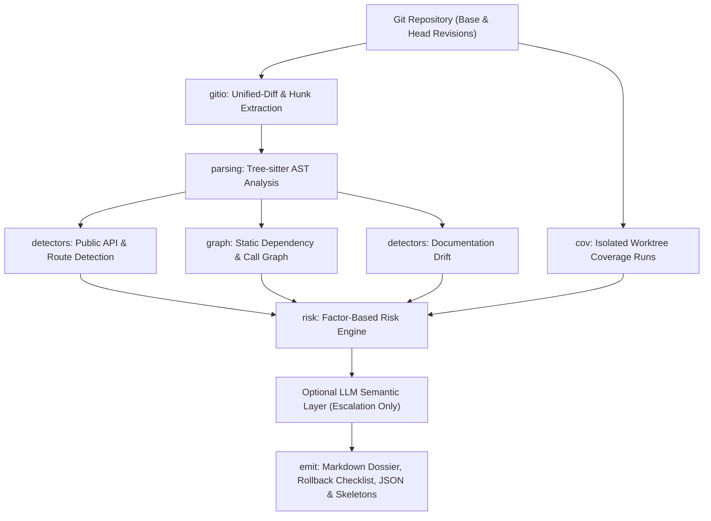

# PR Impact Simulator

<div align="center">

[](https://www.python.org/)
[](https://github.com/Kavya-kakkar/pr-impact-simulator)
[](https://github.com/Kavya-kakkar/pr-impact-simulator)
[](https://mypy-lang.org/)
[](https://github.com/astral-sh/ruff)
[](https://tree-sitter.github.io/)

**Evidence-linked, auditable impact dossier for GitHub pull requests before merge.**  
*What breaks &bull; Who calls it &bull; What tests miss &bull; What docs still claim*

[Features](#what-it-does) &bull;
[Architecture](#architecture) &bull;
[Installation](#install) &bull;
[Run the Demo](#run-the-demo) &bull;
[CLI Reference](#cli) &bull;
[Risk Scoring](#risk-score) &bull;
[Trade-offs](#implementation-trade-offs)

</div>

---

Analyzes a Git repository and produces an **auditable impact dossier** for pull requests prior to merging. It is **not** a style reviewer and it **never guesses**:

> [!NOTE]
> **Zero Unproven Claims:** Every single finding links to an exact source evidence pointer (`path:line@revision`). If the analyzer cannot deterministically establish a claim, the claim is omitted and the reasoning appears under **Limitations** in the dossier.

---

## What It Does

- **Detects Public API Breaking Changes:** Dissects function signatures (added/removed/renamed parameters, order shifts, kinds, defaults, annotations, return types) and FastAPI-style HTTP route declarations (methods, paths, status codes).
- **Traces Downstream Impact:** Constructs a static call graph and follows consumers of each changed symbol up to a configurable depth (`--depth`), classifying every call site as `broken`, `compatible`, or `unknown`.
- **Correlates Coverage Gaps on New Code:** Executes isolated coverage runs for base and head in ephemeral `git worktree` checkouts and correlates **strictly the lines the PR added** with executed lines.
- **Identifies Documentation Drift:** Pinpoints README code examples that no longer match head signatures, as well as documented API endpoints that were deleted or modified.
- **Computes a Transparent Risk Score:** Evaluates a factor-based formula with every raw count, weight, cap, and arithmetic contribution explicitly displayed.
- **Generates Actionable Safeguards:** Automatically produces `dossier.md`, `rollback.md`, `dossier.json`, and incomplete pytest skeletons (`.pr-impact/tests/`) for uncovered surfaces.

---

## Architecture

The system enforces a clean unidirectional pipeline from raw Git revisions to structured artifacts:



### Module Layout

```text
pr_impact/
  ├── gitio.py       Git plumbing + unified-diff parsing (typed hunks)
  ├── parsing.py     Tree-sitter extraction of signatures, routes, imports, calls
  ├── graph.py       Call graph with resolved / ambiguous / unresolved / external edges
  ├── detectors/
  │   ├── api.py     Public API change detection & call-shape mismatch checks
  │   └── docs.py    Markdown code block & endpoint documentation drift
  ├── cov.py         Isolated worktree coverage execution & diff line correlation
  ├── risk.py        Transparent mathematical factor scoring
  ├── llm.py         Optional escalation-only semantic layer
  ├── emit/
  │   ├── dossier.py Markdown & JSON dossier rendering
  │   └── rollback.py Actionable rollback checklist & pytest contract skeletons
  └── pipeline.py    Core orchestration engine; CLI is a thin wrapper
```

The layers communicate via immutable typed records defined in `model.py`. `Change` and `DocDrift` require evidence at construction time, preventing unevidenced claims from ever reaching the output.

---

## Install

Requires **Python 3.11+** and **Git**.

```bash
# 1. Create and activate a virtual environment
python -m venv .venv
.venv\Scripts\activate          # Windows (PowerShell: .\.venv\Scripts\Activate.ps1)
# source .venv/bin/activate     # macOS / Linux

# 2. Install editable package with development tools
pip install -e ".[dev]"

# 3. (Optional) Install Tree-sitter grammars for TypeScript/JavaScript support
pip install tree-sitter-javascript tree-sitter-typescript
```

---

## Run the Demo

The built-in deterministic demo constructs a target repository fixture (`examples/.build/target_repo`) from scratch with a `main` branch and three seeded PR branches, runs full analysis on each, and validates results against hard assertions:

```bash
# Full execution: builds fixtures, runs analysis, prints dossiers & creates artifacts
python demo/run_demo.py

# Quick summary view
python demo/run_demo.py --summary

# Fast run skipping coverage execution
python demo/run_demo.py --no-coverage --summary
```

### Seeded Scenarios & Measured Outcomes

| Branch | Seeded Defect | Measured Result | Risk Verdict |
|---|---|---|:---:|
| `pr/signature-break` | `create_user` gains a required `tenant_id` | 1 breaking change, 3 broken consumers | **MODERATE** (29/100) |
| `pr/untested-endpoint` | New refund route and service without tests | 9 uncovered added lines (95.3% &rarr; 90.3%), 2 skeletons | **LOW** (9/100) |
| `pr/docs-drift` | `amount` renamed to `amount_cents`, route moved | 2 breaking changes, 2 docs drift items | **HIGH** (46/100) |

Generated demo artifacts are written directly to `demo/output/<branch>/`.

---

## CLI

```bash
# Analyze between base branch and HEAD; outputs artifacts to .pr-impact/
pr-impact . --base main --head HEAD

# Print markdown dossier directly to stdout (simulated PR comment)
pr-impact . --head feature/x --print-comment

# CI Gating: exit non-zero (exit code 1) on any breaking change
pr-impact . --fail-on-breaking

# Fast run without coverage; custom output directory
python -m pr_impact . --no-coverage --out /tmp/report
```

### Command-Line Options

| Flag | Default | Description |
|---|:---:|---|
| `repo` | `.` | Path to target Git repository |
| `--base` | `main` | Base revision (branch, tag, or SHA) |
| `--head` | `HEAD` | Head revision (branch, tag, or SHA) |
| `--out` | `.pr-impact` | Destination directory for output artifacts |
| `--depth` | `3` | Maximum hop depth for downstream consumer tracing |
| `--no-coverage` | `False` | Skip `git worktree` coverage runs |
| `--no-llm` | `False` | Disable LLM enrichment even if configured |
| `--print-comment` | `False` | Output the rendered Markdown dossier to `stdout` |
| `--fail-on-breaking` | `False` | Exit with status `1` when any breaking change is detected |

---

## Static Call Graph & Edge Resolution

Every dependency edge records how it was resolved so reviewers can distinguish between untraced calls and zero consumers:

| Resolution State | Meaning | Effect on Downstream Counts |
|---|---|:---:|
| `resolved` | Import chain or local definition proves target identity | Counted in impact |
| `ambiguous` | Receiver type unknown (e.g., dynamic `obj.save()`) | Not counted; reported in Limitations |
| `unresolved` | Import exists but no matching function at that revision | Not counted; reported in Limitations |
| `external` | Builtin, third-party package, or class instantiation | Out of scope |

---

## Risk Score

The overall risk score is calculated using an auditable, bounded linear combination:

$$\text{Risk} = \min\left(100,\ 10 \cdot \min(B, 5) + 3 \cdot \min(C, 20) + 1 \cdot \min(U, 40) + 3 \cdot \min(D, 5) + 5 \cdot \min(M, 5)\right)$$

Where:
- $B$: Classified breaking changes (cap: 5, weight: 10)
- $C$: Incompatible downstream consumers (cap: 20, weight: 3)
- $U$: Uncovered lines added by the PR (cap: 40, weight: 1)
- $D$: Contradicted documentation items (cap: 5, weight: 3)
- $M$: Migration complexity points (cap: 5, weight: 5)

**Migration Points by Change Kind:**
- Removed function or route: **3**
- Changed route or signature: **2**
- Changed HTTP status code: **1**

**Risk Bands:**
- `0 - 19`: **LOW**
- `20 - 39`: **MODERATE**
- `40 - 64`: **HIGH**
- `65 - 100`: **CRITICAL**

> [!TIP]
> Every emitted dossier prints the raw value, cap, weight, contribution, and substituted formula string so reviewers can verify the arithmetic by hand.

---

## Evidence Model

Every claim in the impact dossier links directly to concrete evidence:

| Evidence Kind | Meaning | Example Format |
|---|---|---|
| `source` | Function definition at a revision with line range | `sample_app/services.py:8-9@main` |
| `route` | Decorator line declaring route and status code | `sample_app/api.py:9@pr/docs-drift` |
| `diff` | Changed hunk that introduced the modification | `sample_app/api.py:9@pr/docs-drift` |
| `docs` | Specific line in a Markdown file | `README.md:10@pr/docs-drift` |

---

## Optional LLM Layer

The semantic layer is **disabled by default**. It is activated only when `PR_IMPACT_LLM_URL` is set (pointing to an OpenAI-compatible `/chat/completions` endpoint, with optional `PR_IMPACT_LLM_MODEL` and `PR_IMPACT_LLM_KEY`):

- **Escalation Only:** May escalate a change to `needs-human` when uncertainty remains, or add explanatory prose agreeing with the rule-based verdict.
- **Never Softens:** It **cannot** downgrade a breaking verdict. Any contradicting LLM verdict is rejected and noted in the limitations.
- **No Hallucinated Facts:** The LLM receives strictly pre-extracted facts; it never introduces paths, line numbers, call relationships, or test results.

---

## Implementation Trade-offs

- **Static First, LLM Last:** Facts originate exclusively from Tree-sitter; the LLM can only annotate or escalate. Keeps dossiers reproducible and auditable at the expense of dynamic framework semantics.
- **Diff-Scoped Change Detection:** Only public functions in files modified by the PR are compared, preventing unrelated repository changes from flooding the report.
- **Line-Based Coverage Correlation:** Only lines introduced by the PR are attributed. Shifting line numbers on unchanged lines are never misattributed as coverage regressions.
- **Bounded Consumer Depth:** The default depth of 3 captures `service` &rarr; `client` &rarr; `route` chains without exponential blowup on large dependency graphs.
- **Worktree Isolation:** Coverage executes in detached `git worktree` checkouts with redirected `COVERAGE_FILE` and isolated paths, keeping the repository index and working tree untouched.
- **Read-Only by Default:** In local mode, the analyzer never writes into the analyzed repository (unless explicitly instructed via `--out`) and never pushes commits.

---

## Known Failure Modes & Unsupported Cases

- **Python-Centric:** Full signature, route, and coverage support is tuned for Python. TypeScript/JavaScript support is explicitly best-effort (extracts top-level functions, arrows, class methods, imports, and calls; does not resolve decorators or dynamic dispatch).
- **No Global Type Inference:** Receiver resolution is syntactic. Untyped or interface-typed receivers (`obj.method()`) remain `ambiguous`.
- **Decorator Shape Routing:** Route detection looks for `@router.<method>(...)` patterns. APIRouter composition and runtime prefix mutations are not resolved.
- **Package Re-exports:** Symbols exported through `__init__.py` without explicit sub-module imports by the consumer are not linked.
- **Coverage Suite Requirement:** Requires a functional, runnable pytest suite. Missing dependencies or collection crashes trigger an explicit limitation rather than fabricated coverage.

---

## GitHub Integration

A ready-to-use GitHub Actions workflow is provided at [.github/workflows/pr-impact.yml](file:///c:/Users/kavya/OneDrive/Desktop/PR%20Impact%20Simulator/.github/workflows/pr-impact.yml). It analyzes incoming PRs, uploads the dossier artifacts, and writes a concise step summary.

**Opt-In PR Commenting:**
1. Set the repository variable `PR_IMPACT_COMMENT` to `true`.
2. The commenting job requests `pull-requests: write` only when enabled, shelling out safely via GitHub CLI (`gh`).

---

## Tests & Verification

```bash
# Run full test suite (72 unit and integration tests)
python -m pytest -q

# Run with test coverage
coverage run -m pytest
coverage report

# Static type verification
mypy pr_impact

# Linting and style validation
ruff check
```

**Quality Guarantee:**
- **72 / 72** automated tests passing.
- **92%** total code coverage across all modules.
- **100%** clean static typing under `mypy`.
- Zero linter warnings under `ruff`.

---

## License

MIT License. See [LICENSE](file:///c:/Users/kavya/OneDrive/Desktop/PR%20Impact%20Simulator/LICENSE) for details.
